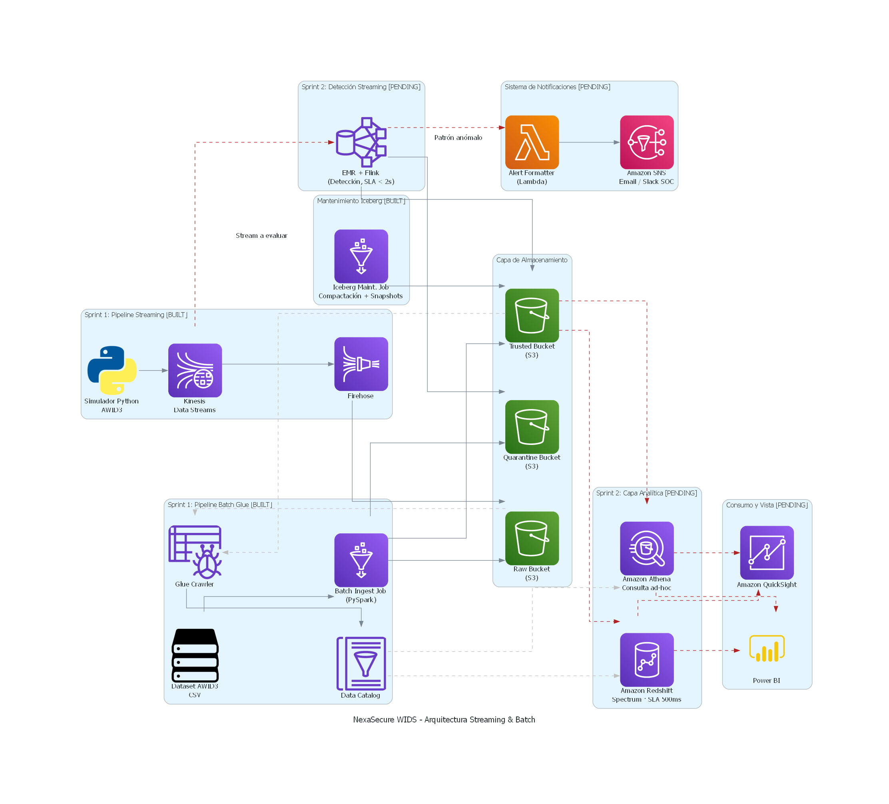

# NexaSecure WIDS (Wi-Fi Intrusion Detection System)

NexaSecure WIDS es una plataforma analítica integral basada en AWS diseñada para la ingesta, procesamiento, almacenamiento y detección de intrusiones en redes Wi-Fi, utilizando el dataset **AWID3** como fuente de datos (eventos 802.11). 

El proyecto adopta una arquitectura de **Lakehouse** sobre Amazon S3 con el formato **Apache Iceberg**, garantizando la inmutabilidad de los datos crudos (Raw), la seudonimización de información sensible (Trusted) y la gestión de calidad de datos (Quarantine). Todo bajo un modelo Serverless y de Infraestructura como Código (IaC).

Este es un proyecto académico desarrollado por estudiantes de Ingeniería de Sistemas de la Universidad EAFIT (Medellín, Colombia), en el marco de la asignatura SI4002 - Proyecto de Ingeniería de Datos, semestre 2026-2.
 
### Equipo de trabajo
 
| Nombre completo | Rol principal |
|---|---|
| Daniel Arcila Salazar | Arquitecto de Datos / Cloud |
| Luis Ángel Nerio Pereira | Ingeniero de Pipelines / Big Data |
| Sebastián Durán Fernández | Oficial de Gobernanza y Calidad |
| Cesar Montoya Giraldo | Líder Técnico / DataOps |
 
---
 
## Estado del proyecto (Sprint 2 — Producto Beta)

Construido y funcional:
- Infraestructura base en AWS (buckets S3, Secrets Manager, Glue Data Catalog, Kinesis + Firehose).
- Ruta de ingesta batch: Glue Job que valida (calibrado por tipo de trama 802.11), seudonimiza y separa los datos entre Trusted y Quarantine.
- Ruta de ingesta en streaming: `flink-app` sobre Amazon EMR, que valida, seudonimiza y evalúa reglas de detección en tiempo real (Deauth Flood, Rogue AP, Disas Burst) con alertas publicadas a SQS/SNS vía `alert_formatter`.
- Job de mantenimiento de Iceberg (compactación de archivos y expiración de snapshots).
- Infraestructura transaccional en RDS PostgreSQL privado y cifrado: tres migraciones aplicadas para el catálogo de reglas, alertas, casos de incidente y bitácora de auditoría, con RBAC de 2 perfiles (`security_analyst`, `auditor`). La integración del consumidor y el llenado de la bitácora siguen pendientes del equipo.
- **Optimización analítica implementada:** particiones por fecha/etiqueta, orden por BSSID y bloom filters sobre `trusted_awid3`, con [comparativo reproducible en Athena](docs/optimizacion/iceberg/evidencia/resultados.md). En RDS están aplicados los índices BRIN/GIN/parcial/compuesto; el comparativo de César requiere que Luis genere alertas.
- Gobernanza consolidada en `DATA_GOVERNANCE.md` (diccionario de datos, catálogo, linaje, matriz RACI, reglas de calidad).
- Módulos de validación, seudonimización y detección probados con pruebas unitarias (pytest).

Pendiente para el Sprint Final (fuera de alcance de Sprint 2 por definición de la rúbrica):
- Capa de consumo: Amazon Athena / Redshift Spectrum y el dashboard operativo (QuickSight o Power BI).
- DataOps: CI/CD, observabilidad y monitoreo de los pipelines en producción.


### Diagrama de arquitectura (Actual):


La versión final del diagrama se mantiene en draw.io y está exportada en
[PNG](docs/nexasecure_wids_-_arquitectura_streaming_&_batch.png) y
[PDF](docs/nexasecure_wids_-_arquitectura_streaming_&_batch.pdf).
`docs/architecture.py` conserva la generación de la versión anterior con Diagrams;
ejecutarlo vuelve a generar el PNG en la misma ruta. Para actualizar el diagrama
final, editarlo en draw.io y exportar nuevamente el PNG y el PDF.

### Entregables de Daniel: RDS y optimización Iceberg

- [RDS: despliegue, migraciones y parámetros para la integración](infrastructure/serverless/rds/README.md).
- [Iceberg: migración de Trusted y benchmark reproducible en Athena](docs/optimizacion/iceberg/procedimiento.md).
- [Evidencias del comparativo](docs/optimizacion/iceberg/evidencia/).
- [Capturas manuales de RDS, Glue y Athena](docs/evidencias_capturas/).

Los entregables de Daniel están implementados: despliegue de RDS y aplicación de
las tres migraciones, optimización de Trusted, comparativo en Athena y actualización
del diagrama. La migración de Trusted conservó sus 374.983 registros; se verificaron
bloom filters físicos de BSSID en los 10 archivos finales, con un límite de 4 KiB.

| Consulta Athena | Mediana antes | Mediana después | Reducción de bytes leídos |
|---|---:|---:|---:|
| Fecha y etiqueta | 1.040 ms | 673 ms | 92,74% |
| BSSID | 771 ms | 1.474 ms | 46,63% |

La consulta BSSID leyó menos datos, pero su tiempo mediano aumentó en esta muestra.
Las consultas, resultados e identificadores de ejecución están guardados en las
evidencias del comparativo.

La integración del consumidor con RDS y la generación de alertas corresponden a
Luis; el benchmark de índices de RDS corresponde a César, una vez existan datos.
Los perfiles IAM de personas y la auditoría de consultas corresponden a Sebastián.

Los comandos de `scripts/` usan las credenciales locales de `.envs/aws.env`
en `us-east-1`; la infraestructura está preparada para una cuenta AWS normal.
Antes de ejecutar la nueva ingesta batch sobre una Trusted existente, completar
`TrustedOptimizationJob`. No reiniciar bookmarks ni volver a cargar Raw para
aplicar el cambio de particiones.

---

##  Arquitectura y Componentes del Sistema

El monorepositorio está dividido en módulos específicos según su propósito en el ciclo de vida del dato:

### 1. `infrastructure/` (Infraestructura como Código)
Contiene los stacks de Serverless Framework para desplegar la infraestructura en AWS de manera declarativa. Se dividen en:
* **`secrets/`**: Gestiona las llaves criptográficas (KMS) y secretos (Secrets Manager), como la llave HMAC usada para seudonimizar direcciones MAC.
* **`storage/`**: Crea los buckets de S3 para las capas del Lakehouse (`Raw`, `Trusted`, `Quarantine`) y publica sus nombres en el Parameter Store (SSM) de AWS.
* **`streaming/`**: Configura un **Kinesis Data Stream** como bus de entrada para eventos en tiempo real, acoplado con **Kinesis Data Firehose** para guardar automáticamente los eventos `.json` crudos en el bucket Raw (zona `raw/streaming/`).
* **`glue/`**: Implementa el ecosistema batch y el catálogo de datos. Crea el **Glue Data Catalog**, los **Glue Crawlers** (para detectar esquemas), los **Triggers** y los **Glue Jobs** (Spark) que procesan la información.
* **`emr/`**: Clúster Amazon EMR sobre EC2 con un consumidor Python/boto3. La ejecución con el motor PyFlink sigue pendiente.
* **`rds/`**: PostgreSQL privado para el catálogo de reglas, alertas, casos y auditoría; credenciales en Secrets Manager y migraciones mediante un ejecutor SSM temporal.

### 2. `ingestion-tools/` (Simulador de Datos desde Kaggle)
Herramientas de desarrollo local en Python (aisladas en su propio contenedor Docker) para inyectar datos reales del dataset AWID3 sin descargar los 46GB completos, ahorrando costos y ancho de banda.
* **`kaggle_batch_loader.py`**: Descarga subconjuntos (ej. `CSV/1.Deauth/`) y sube los CSVs íntegros a la zona `landing/batch/` del bucket Raw.
* **`kaggle_stream_simulator.py`**: Convierte filas de los CSVs a formato JSON y las inyecta evento por evento en el **Kinesis Data Stream** a una tasa controlada (`--rate`), simulando tráfico en tiempo real.

### 3. `glue-jobs/` (Procesamiento Batch - Apache Spark)
Scripts de PySpark que se ejecutan sin servidor en AWS Glue 4.0.
* **`batch_ingest_job.py`**: El corazón del pipeline Batch. 
  1. Lee los CSV crudos de `landing/batch/`.
  2. Guarda una copia inmutable en la tabla Iceberg de **Raw** (`raw/`).
  3. Ejecuta reglas de calidad de datos (Quality Gates). Si la fila falla, se envía en formato Parquet a **Quarantine** (`quarantine/batch/`).
  4. Si es válida, seudonimiza las direcciones MAC (`wlan.sa`, `wlan.da`, `wlan.bssid`) usando HMAC.
  5. Escribe el resultado limpio y seguro en la tabla Iceberg de **Trusted** (`trusted/`).
* **`compaction_job.py`**: Mantenimiento automático de Apache Iceberg (Compactación de archivos pequeños y limpieza de Snapshots antiguos).

---

##  Seguridad y Cumplimiento (Privacy by Design)

El pipeline de ingesta fue diseñado bajo el principio de minimización de datos para cumplir con normativas de privacidad. 

Las direcciones MAC de los dispositivos (columnas `wlan.sa`, `wlan.da`, `wlan.bssid`) son ofuscadas en la capa **Trusted** mediante un algoritmo de **Seudonimización Criptográfica**:
- **Se preserva el OUI (Primeros 3 octetos):** Por ejemplo, en la MAC `74:d0:2b:d906e028`, la parte `74:d0:2b` se mantiene en texto claro. Esto permite a los modelos analíticos y de ML seguir identificando al fabricante del hardware (útil para detectar vulnerabilidades específicas).
- **Se cifra la identidad del usuario (Últimos octetos):** El resto de la dirección MAC original se pasa por una función hash **HMAC SHA-256** utilizando una llave secreta custodiada de forma segura en **AWS Secrets Manager**, generando un sufijo alfanumérico seguro (`d906e028`).
- Esto garantiza que el rastreo sea posible para detectar intrusiones recurrentes, pero oculta la identidad real del dispositivo, protegiendo la privacidad del usuario final.

---

##  Guía de Ejecución (Paso a Paso)

Sigue estos pasos para desplegar y probar la arquitectura completa desde cero.

### Fase 0: Preparación del Entorno y Archivos Locales (.envs)
Por seguridad, las credenciales no se suben al repositorio. Antes de empezar, debes crear la carpeta `.envs/` en la raíz del proyecto y generar los siguientes 3 archivos:

1. **`.envs/aws.env`** (Credenciales de AWS para despliegue y acceso):
   ```env
   AWS_ACCESS_KEY_ID=tu_access_key
   AWS_SECRET_ACCESS_KEY=tu_secret_key
   AWS_DEFAULT_REGION=us-east-1
   ```
2. **`.envs/kaggle.env`** (Credenciales Legacy de Kaggle para descargar el dataset AWID3):
   ```env
   KAGGLE_USERNAME=tu_usuario_de_kaggle
   KAGGLE_KEY=tu_api_key_legacy_de_kaggle
   ```
3. **`.envs/sls.env`** (Opcional, variables para Serverless Framework si usas el dashboard de SLS):
   ```env
   SLS_ORG=tu_organizacion_en_serverless
   ```

Una vez creados estos archivos, la estructura local de tu proyecto estará lista para ser montada por Docker y los DevContainers.

### Fase 1: Despliegue de Infraestructura (AWS)
1. Abre la carpeta `infrastructure` en VS Code (usa el DevContainer para asegurar Node.js y Serverless Framework).
2. Autentícate en tu cuenta de AWS (`aws configure` o `aws sso login`).
3. Despliega los stacks en orden estricto (ya que unos dependen de los parámetros de otros):
   ```bash
   cd serverless/secrets && serverless deploy
   cd ../storage && serverless deploy
   cd ../streaming && serverless deploy
   cd ../glue && serverless deploy
   ```

### Fase 2: Iniciar las Herramientas de Ingesta
1. Abre la carpeta `ingestion-tools` en VS Code (reabre en su propio DevContainer) o levántalo manualmente:
   ```bash
   cd ingestion-tools/.docker
   docker-compose up -d --build
   docker exec -it NexaSecureIngestionTools bash
   ```

### Fase 3: Probar el flujo Streaming (Kinesis -> Firehose -> S3)
Desde dentro del contenedor de `ingestion-tools`:
1. Envía tráfico en tiempo real consumiendo la porción de **Streaming** (segundo 50% de las categorías seleccionadas):
   ```bash
   # Varias categorías de ataque simultáneas (ej. 30 eventos por cada una):
   python -m src.kaggle_stream_simulator --categories "1.Deauth" "2.Disas" "10.SQL_Injection" --limit-per-cat 30 --rate 10

   # O todas las 13 categorías del dataset AWID3:
   python -m src.kaggle_stream_simulator --all-categories --limit-per-cat 20 --rate 10

   # O un solo archivo específico:
   python -m src.kaggle_stream_simulator --kaggle-path "CSV/1.Deauth/Deauth_0.csv" --limit 50 --rate 10
   ```
2. **Validación:** Espera ~60 segundos (el tiempo de búfer de Firehose). En la consola de AWS (o vía CLI), revisa el bucket Raw. Verás archivos `.json` estructurados por año/mes/día/hora en la ruta `raw/streaming/`.

### Fase 4: Probar el flujo Batch (Landing -> Glue -> Iceberg)
Desde dentro del contenedor de `ingestion-tools`:
1. Sube la porción destinada a **Batch** (primer 50% de las categorías seleccionadas) a la zona de aterrizaje:
   ```bash
   # Varias categorías de ataque (sube 1 archivo muestra por cada una):
   python -m src.kaggle_batch_loader --categories "1.Deauth" "2.Disas" "10.SQL_Injection" --limit-files 1

   # O todas las 13 categorías de AWID3 (1 archivo por categoría):
   python -m src.kaggle_batch_loader --all-categories --limit-files 1

   # O una categoría o archivo individual:
   python -m src.kaggle_batch_loader --kaggle-path "CSV/1.Deauth/Deauth_0.csv" --split-mode files
   ```

Desde el contenedor de `infrastructure`:
2. Si actualizaste el código de los scripts de Spark, despliega el stack de Glue (Serverless sincroniza los scripts a S3 automáticamente):
   ```bash
   cd /app/infrastructure/serverless/glue
   ./deploy.sh
   # (o simplemente: serverless deploy)
   ```
3. Ejecuta el Job Batch de Glue:
   ```bash
   JOB_NAME=$(aws ssm get-parameter --name /nexasecure/dev/glue/BatchIngestJobName --query Parameter.Value --output text)
   aws glue start-job-run --job-name $JOB_NAME
   ```
4. **Validación:** El Job de Glue tardará ~4 a 6 minutos. Una vez el estado del Job cambie a `SUCCEEDED`, podrás verificar los resultados de dos formas:

   **A) Verificación Física en Amazon S3:**
   - Ve a la consola de **Amazon S3**.
   - En tu bucket Raw (`nexasecure-wids-awid3-raw-dev-local`), entra a la ruta `iceberg-warehouse/glue_catalog/nexasecure_wids_catalog_dev_local/raw_awid3/`. Verás las carpetas `data/` (archivos Parquet inmutables) y `metadata/` (historial de Iceberg).
   - En tu bucket Trusted (`nexasecure-wids-awid3-trusted-dev-local`), entra a `iceberg-warehouse/glue_catalog/nexasecure_wids_catalog_dev_local/trusted_awid3/`. Verás la misma estructura de Iceberg, pero la data ya está limpia y ofuscada.
   - En tu bucket Quarantine (`nexasecure-wids-awid3-quarantine-dev-local`), si hubo filas inválidas (ej. payload gigante), las verás en `quarantine/batch/` en formato Parquet nativo.

   **B) Verificación Lógica con SQL en Amazon Athena (Recomendado):**
   - Ve a la consola de **AWS Glue** > Panel Izquierdo > **Databases**. Verifica que existe la base de datos `nexasecure_wids_catalog_dev_local` y que adentro contiene las tablas `raw_awid3` y `trusted_awid3`.
   - Ve a la consola de **Amazon Athena**.
   - En el editor de consultas (Query Editor), selecciona:
     - Data source: `AwsDataCatalog`
     - Database: `nexasecure_wids_catalog_dev_local`
   - Ejecuta esta consulta para ver la data inmutable:
     ```sql
     SELECT * FROM raw_awid3 LIMIT 10;
     ```
   - Ejecuta esta consulta para comprobar la **seudonimización** de las MACs en la capa Trusted:
     ```sql
     SELECT "wlan.sa", "wlan.da", "wlan.bssid" FROM trusted_awid3 LIMIT 10;
     ```
     Verás que en lugar de direcciones MAC reales (ej. `00:11:22:33:44:55`), aparecerán hashes criptográficos (ej. `00:11:22:a1b2c3d4`).

---

##  Tecnologías Utilizadas
* **AWS:** S3, Kinesis Streams, Kinesis Firehose, AWS Glue (Spark Serverless), Secrets Manager, KMS, Parameter Store (SSM).
* **Formatos Analíticos:** Apache Iceberg, Apache Parquet.
* **Infraestructura y Herramientas:** Serverless Framework, Docker, Python 3.11, Pandas, KaggleHub.
