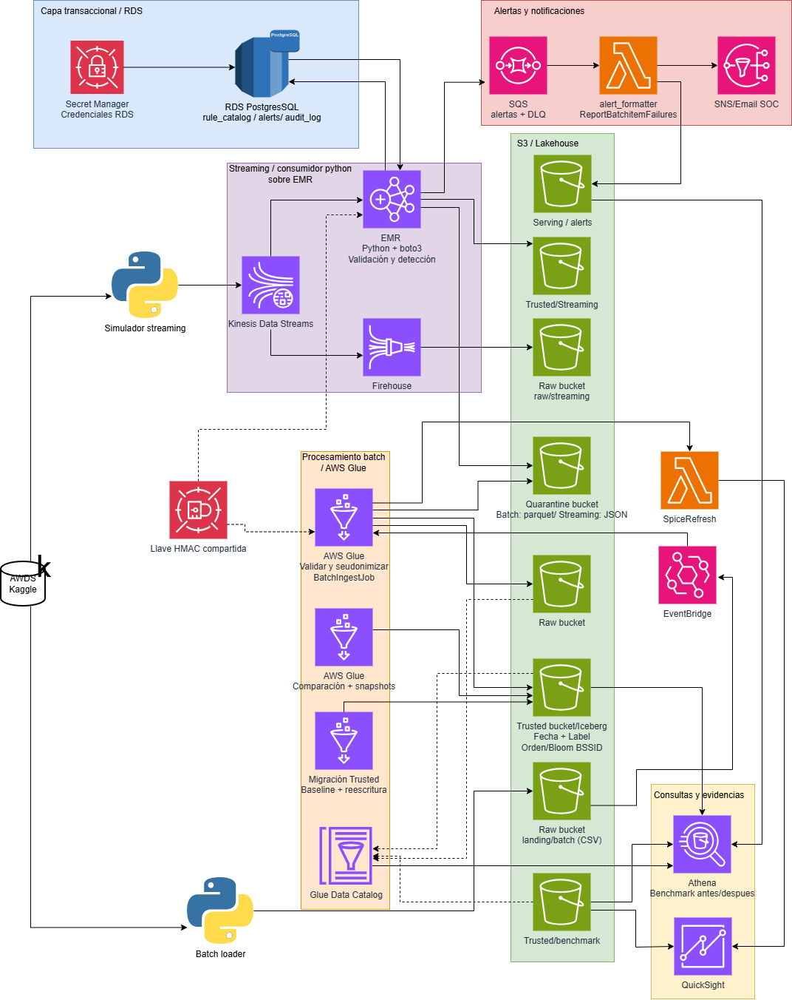

# NexaSecure WIDS (Wi-Fi Intrusion Detection System)

NexaSecure WIDS es una plataforma analítica integral basada en AWS diseñada para la ingesta, procesamiento, almacenamiento y detección de intrusiones en redes Wi-Fi, utilizando el dataset **AWID3** como fuente de datos (eventos 802.11). 

El proyecto adopta una arquitectura de **Lakehouse** sobre Amazon S3 con el formato **Apache Iceberg**, garantizando la inmutabilidad de los datos crudos (Raw), la seudonimización de información sensible (Trusted) y la gestión de calidad de datos (Quarantine). Todo bajo un modelo Serverless y de Infraestructura como Código (IaC).

Este es un proyecto académico desarrollado por estudiantes de Ingeniería de Sistemas de la Universidad EAFIT (Medellín, Colombia), en el marco de la asignatura SI4002 - Proyecto de Ingeniería de Datos, semestre 2026-2.
 
### Equipo de trabajo
 
| Nombre completo | Rol principal |
|---|---|
| Daniel Arcila Salazar | Arquitecto de Datos / Cloud |
| Luis Ángel Nerio Pereira | Ingeniero de Pipelines / Big Data |
| Sebastián Durán Fernández | Oficial de Gobernanza y Calidad |
| Cesar Montoya Giraldo | Líder Técnico / DataOps |
 
---
 
## Estado del proyecto (Sprint Final — Producto Completo)

Construido y funcional de extremo a extremo:
- **Infraestructura base en AWS:** buckets S3 (`Raw`, `Trusted`, `Quarantine`), Secrets Manager, KMS, Glue Data Catalog, Kinesis Data Streams + Data Firehose, colas SQS + DLQ y tópicos SNS.
- **Ruta de ingesta batch automatizada:** eventos de creación de objetos en `landing/batch/` sobre S3 disparan automáticamente en EventBridge el Glue Workflow (`nexasecure_batch_workflow_{stage}_{dev}`), que ejecuta el Glue Job de validación (calibrado por tipo de trama 802.11), seudonimización HMAC y separación entre `trusted_awid3` (Iceberg) y `quarantine`, seguido de los Glue Crawlers y la recarga automática de SPICE en QuickSight mediante la Lambda `spiceRefresh`. Incluye respaldos diarios programados (ingesta a las 02:00 y mantenimiento/compactación de Iceberg a las 03:00 America/Bogota).
- **Ruta de ingesta y detección en streaming:** `flink-app` sobre Amazon EMR (`KeepJobFlowAliveWhenNoSteps: true`), que consume desde Kinesis Data Streams midiendo la latencia real desde `ApproximateArrivalTimestamp`, valida, seudonimiza y evalúa 4 reglas de detección en tiempo real (`DEAUTH_FLOOD`, `ROGUE_AP`, `DISAS_BURST`, `SSDP_FLOOD`). Las alertas se publican en SQS y son procesadas por la Lambda `alertFormatter`, que notifica por correo vía SNS y persiste cada alerta de forma idempotente en la zona Serving (`s3://<trusted>/serving/alerts/dt=YYYY-MM-DD/`).
- **Infraestructura transaccional en RDS PostgreSQL 16 (privado y cifrado):** tres migraciones aplicadas para el catálogo de reglas, alertas, casos de incidente y bitácora de auditoría, con RBAC de 2 perfiles (`security_analyst`, `auditor`) e índices optimizados (BRIN, GIN, parcial y compuesto) validados con 50.000 alertas.
- **Capa de consumo analítico y BI (Athena + QuickSight):** tabla Glue `alerts_serving` con *partition projection*, workgroup de Athena `nexasecure-consumption-{stage}` con límite de 1 GiB por consulta, 4 vistas Serving (`vw_alerts`, `vw_alerts_hourly`, `vw_traffic_daily`, `vw_top_bssid`) y dashboard operativo **NexaSecure WIDS - SOC** en Amazon QuickSight desplegado como código (13 visuales en 3 pestañas: *Resumen Ejecutivo*, *Alertas en Vivo* en Direct Query y *Tráfico Batch* en SPICE).
- **DataOps — CI/CD (`.github/workflows/ci-cd.yml`):** pipeline en GitHub Actions que ejecuta las suites de pruebas unitarias de los 5 módulos (`flink-app`, `backend`, `ingestion-tools`, `scripts`, `glue-jobs`), valida la consistencia del handler (`handler-consistency`) y despliega continuamente en AWS mediante federación OIDC (sin llaves de largo plazo almacenadas en GitHub) la Lambda `alertFormatter` (con prueba de humo), el detector en EMR y los scripts de Glue.
- **DataOps — Monitoreo y Observabilidad (`infrastructure/serverless/monitoring/`):** tópico SNS de operaciones (`nexasecure-ops-alerts-{stage}`), alarmas de CloudWatch (DLQ, cola SQS, Lambda `alertFormatter`, Kinesis, Firehose, RDS y métricas del detector en el namespace `NexaSecure/WIDS`), reglas de EventBridge para fallos de Glue Jobs/Workflows y pasos de EMR, presupuesto mensual (`AWS::Budgets::Budget`) y dashboard operativo en CloudWatch (`nexasecure-wids-{stage}`).
- **Optimización analítica y transaccional verificada:** particiones por fecha/etiqueta, orden por BSSID y *bloom filters* sobre `trusted_awid3` ([comparativo reproducible en Athena](docs/optimizacion/iceberg/evidencia/resultados.md)), más benchmark de índices en RDS PostgreSQL ([evidencia Seq Scan vs. Index Scan](docs/evidencias_capturas/rds/06_demo_indexes_seqscan_vs_indexscan.txt)).
- **Gobernanza consolidada:** documentada en [`DATA_GOVERNANCE.md`](DATA_GOVERNANCE.md) (diccionario de datos, catálogo, linaje, matriz RACI, reglas de calidad y control de acceso).


### Diagrama de arquitectura (Streaming & Batch)


La versión final del diagrama se mantiene en draw.io y está exportada en
[PNG](docs/nexasecure_wids_-_arquitectura_streaming_&_batch.png).
`docs/architecture.py` conserva la generación programática con Diagrams.

### Diagrama de monitoreo y observabilidad (DataOps)


Representa la arquitectura de observabilidad extremo a extremo: recolección de métricas y logs en CloudWatch (Kinesis, EMR/`NexaSecure/WIDS`, SQS/DLQ, Lambda, Glue, Firehose y RDS), detección de eventos operativos con EventBridge, control presupuestal con AWS Budgets y notificación centralizada al equipo mediante Amazon SNS (`nexasecure-ops-alerts-{stage}`).

### Optimización de consultas: Iceberg (Athena) y PostgreSQL (RDS)

- [RDS: despliegue, migraciones y parámetros para la integración](infrastructure/serverless/rds/README.md).
- [Iceberg: migración de Trusted y benchmark reproducible en Athena](docs/optimizacion/iceberg/procedimiento.md).
- [Evidencias del comparativo en Iceberg](docs/optimizacion/iceberg/evidencia/).
- [Evidencia de índices en RDS (`Seq Scan` vs. `Index Scan`)](docs/evidencias_capturas/rds/06_demo_indexes_seqscan_vs_indexscan.txt).
- [Capturas de RDS, Glue y Athena](docs/evidencias_capturas/).

La migración de `trusted_awid3` conservó sus 374.983 registros y verificó *bloom filters* físicos de BSSID en los archivos Parquet finales (límite de 4 KiB):

| Consulta Athena (Iceberg `trusted_awid3`) | Mediana antes | Mediana después | Reducción de bytes leídos |
|---|---:|---:|---:|
| Fecha y etiqueta | 1.040 ms | 673 ms | 92,74% |
| BSSID | 771 ms | 1.474 ms | 46,63% |

En la capa transaccional (RDS PostgreSQL 16 con 50.000 alertas sembradas mediante `scripts/rds_benchmark_remote.py`), la creación del índice compuesto parcial `idx_alerts_type_sev_time` sobre `alerts (rule_type, severity, window_start DESC)` redujo el tiempo de consulta de alertas críticas recientes en **68,8x**:

| Consulta RDS (`alerts` — 50.000 filas) | Sin índice (`Seq Scan`) | Con índice (`Bitmap Index Scan`) | Mejora |
|---|---:|---:|---:|
| Filtrado por `rule_type`, `severity` y ventana temporal | 7,09 ms | 0,10 ms | **68,8x más rápido** |

Los comandos de `scripts/` usan las credenciales locales de `.envs/aws.env`
en `us-east-1`. Antes de ejecutar una ingesta batch sobre una tabla `trusted_awid3` previa al cambio de particiones, asegúrate de haber completado `TrustedOptimizationJob`.

---

## Arquitectura y Componentes del Sistema

El monorepositorio está dividido en módulos específicos según su propósito en el ciclo de vida del dato:

### 1. `infrastructure/` (Infraestructura como Código)
Contiene los stacks de Serverless Framework para desplegar la infraestructura en AWS de manera declarativa:
* **`secrets/`**: Gestiona las llaves criptográficas (KMS) y secretos (Secrets Manager), como la llave HMAC usada para seudonimizar direcciones MAC.
* **`storage/`**: Crea los buckets de S3 para las capas del Lakehouse (`Raw`, `Trusted`, `Quarantine`) con notificaciones a EventBridge y publica sus nombres en AWS Systems Manager Parameter Store (SSM).
* **`queue/`**: Aprovisiona la cola principal de alertas en **Amazon SQS** y su **Dead-Letter Queue (DLQ)** con retención y política de reintentos.
* **`notifications/`**: Crea el tópico **Amazon SNS** de alertas de seguridad (`nexasecure-alerts-{stage}`) y gestiona las suscripciones de correo del SOC.
* **`streaming/`**: Configura el **Kinesis Data Stream** como bus de entrada para eventos 802.11 en tiempo real, acoplado con **Kinesis Data Firehose** para archivar automáticamente los eventos `.json` crudos en el bucket Raw (`raw/streaming/`).
* **`glue/`**: Implementa el ecosistema batch y el catálogo de datos: **Glue Data Catalog**, **Glue Crawlers**, **Glue Jobs** (PySpark), **Glue Workflow** automatizado por eventos S3/EventBridge y la Lambda `spiceRefresh` que actualiza QuickSight tras cada ingesta.
* **`emr/`**: Clúster **Amazon EMR** sobre EC2 (`KeepJobFlowAliveWhenNoSteps: true`) que ejecuta el motor de detección en streaming sobre los eventos de Kinesis y publica métricas operativas en CloudWatch.
* **`rds/`**: Instancia **Amazon RDS (PostgreSQL 16)** en subred privada y cifrada con KMS para el catálogo de reglas, alertas, casos de incidente y bitácora de auditoría; credenciales en Secrets Manager y ejecución remota vía SSM.
* **`monitoring/`**: Observabilidad y DataOps: tópico SNS operativo (`nexasecure-ops-alerts-{stage}`), alarmas de CloudWatch (DLQ, SQS, Lambda, Kinesis, Firehose, RDS y detector WIDS), reglas de EventBridge para fallos en Glue y EMR, presupuesto mensual (`AWS::Budgets::Budget`) y dashboard de CloudWatch.
* **`consumption/`**: Capa de consumo analítico: tabla Glue `alerts_serving` con *partition projection* sobre `s3://<trusted>/serving/alerts/` y workgroup de Athena `nexasecure-consumption-{stage}` con control de costos por consulta (1 GiB).
* **`quicksight/`**: Despliegue como código (plugin `quicksight.js`) de los datasets, el análisis editable y el dashboard **NexaSecure WIDS - SOC** en Amazon QuickSight (13 visuales y recarga programada de SPICE).
* **`cicd/`**: Proveedor de identidad OIDC de GitHub Actions e IAM Role con permisos de mínimo privilegio para despliegue continuo sin credenciales estáticas.

### 2. `ingestion-tools/` (Simulador de Datos desde Kaggle)
Herramientas en Python (aisladas en su propio contenedor Docker) para inyectar datos reales del dataset AWID3 desde Kaggle sin descargar los 46 GB completos:
* **`kaggle_batch_loader.py`**: Descarga subconjuntos (ej. `CSV/11.SSDP/SSDP_31.csv`) y sube los CSV íntegros a la zona `landing/batch/` del bucket Raw.
* **`kaggle_stream_simulator.py`**: Convierte filas de los CSV a formato JSON y las inyecta evento por evento en el **Kinesis Data Stream** a una tasa controlada (`--rate`), simulando tráfico Wi-Fi en tiempo real.

### 3. `glue-jobs/` (Procesamiento Batch — Apache Spark)
Scripts de PySpark que se ejecutan sin servidor en AWS Glue 4.0:
* **`batch_ingest_job.py`**: El corazón del pipeline Batch:
  1. Lee los CSV crudos de `landing/batch/`.
  2. Guarda una copia inmutable en la tabla Iceberg de **Raw** (`raw_awid3`).
  3. Ejecuta reglas de calidad de datos (*Quality Gates* calibrados por subtipo 802.11). Si la fila falla, se envía en formato Parquet a **Quarantine** (`quarantine/batch/`).
  4. Si es válida, seudonimiza las direcciones MAC (`wlan.sa`, `wlan.da`, `wlan.bssid`) preservando el OUI y aplicando HMAC-SHA256.
  5. Escribe el resultado limpio y particionado en la tabla Iceberg de **Trusted** (`trusted_awid3`).
* **`compaction_job.py`**: Mantenimiento automático de Apache Iceberg (compactación de archivos pequeños y expiración de snapshots antiguos).
* **`trusted_optimization_job.py`**: Migración y optimización física de `trusted_awid3` (particionado por fecha/etiqueta, ordenamiento por BSSID y *bloom filters*).

### 4. `flink-app/` (Detección en Tiempo Real — Streaming)
Motor de procesamiento de eventos en streaming desplegado sobre Amazon EMR:
* **`detection_job.py` / `emr_runner.py`**: Consume tramas desde Kinesis Data Streams, aplica validación de esquema y seudonimización HMAC en memoria, evalúa ventanas deslizantes para las 4 reglas (`DEAUTH_FLOOD`, `ROGUE_AP`, `DISAS_BURST`, `SSDP_FLOOD`), calcula la latencia de extremo a extremo desde `ApproximateArrivalTimestamp`, emite alertas a SQS y publica métricas personalizadas en CloudWatch (`NexaSecure/WIDS`).

### 5. `backend/` (Procesamiento Serverless de Alertas y Base de Datos RDS)
* **`src/alert_formatter/` y `serverless/alerts/`**: Función AWS Lambda (`alertFormatter`) disparada por SQS que valida el contrato de la alerta, formatea y publica la notificación para el SOC en Amazon SNS y almacena cada alerta de forma idempotente en `s3://<trusted>/serving/alerts/dt=YYYY-MM-DD/` para su consulta inmediata en Athena y QuickSight.
* **`database/rds/`**: Esquema SQL, migraciones versionadas (`001` a `003`), control de acceso basado en roles (RBAC) y script de benchmark de índices (`demo_indexes.py`) para PostgreSQL.

### 6. `scripts/` y `.github/workflows/` (Automatización, Vistas y CI/CD)
* **`scripts/athena_views.py`**: Crea y verifica en Athena las 4 vistas de la capa Serving (`vw_alerts`, `vw_alerts_hourly`, `vw_traffic_daily`, `vw_top_bssid`).
* **`scripts/rds.py`, `scripts/rds_migrate_remote.py` y `scripts/rds_benchmark_remote.py`**: Empaquetado, despliegue, migración y benchmark remoto de índices en la instancia privada de RDS vía túnel/ejecutor SSM.
* **`.github/workflows/ci-cd.yml`**: Flujo automatizado de integración y entrega continua en GitHub Actions.

---

##  Seguridad y Cumplimiento (Privacy by Design)

El pipeline de ingesta fue diseñado bajo el principio de minimización de datos para cumplir con normativas de privacidad. 

Las direcciones MAC de los dispositivos (columnas `wlan.sa`, `wlan.da`, `wlan.bssid`) son ofuscadas en la capa **Trusted** mediante un algoritmo de **Seudonimización Criptográfica**:
- **Se preserva el OUI (Primeros 3 octetos):** Por ejemplo, en la MAC `74:d0:2b:d906e028`, la parte `74:d0:2b` se mantiene en texto claro. Esto permite a los modelos analíticos y de ML seguir identificando al fabricante del hardware (útil para detectar vulnerabilidades específicas).
- **Se cifra la identidad del usuario (Últimos octetos):** El resto de la dirección MAC original se pasa por una función hash **HMAC SHA-256** utilizando una llave secreta custodiada de forma segura en **AWS Secrets Manager**, generando un sufijo alfanumérico seguro (`d906e028`).
- Esto garantiza que el rastreo sea posible para detectar intrusiones recurrentes, pero oculta la identidad real del dispositivo, protegiendo la privacidad del usuario final.

---

##  Guía de Ejecución (Paso a Paso)

Sigue estos pasos para desplegar y probar la arquitectura completa desde cero.

### Fase 0: Preparación del Entorno y Archivos Locales (.envs)
Por seguridad, las credenciales no se suben al repositorio. Antes de empezar, debes crear la carpeta `.envs/` en la raíz del proyecto y generar los siguientes 3 archivos:

1. **`.envs/aws.env`** (Credenciales de AWS para despliegue y acceso):
   ```env
   AWS_ACCESS_KEY_ID=tu_access_key
   AWS_SECRET_ACCESS_KEY=tu_secret_key
   AWS_DEFAULT_REGION=us-east-1
   ```
2. **`.envs/kaggle.env`** (Credenciales Legacy de Kaggle para descargar el dataset AWID3):
   ```env
   KAGGLE_USERNAME=tu_usuario_de_kaggle
   KAGGLE_KEY=tu_api_key_legacy_de_kaggle
   ```
3. **`.envs/sls.env`** (Variables para Serverless Framework, notificaciones y QuickSight):
   ```env
   SLS_ORG=tu_organizacion_en_serverless
   ALERT_EMAIL=tu_correo@dominio.com
   QUICKSIGHT_USER_ARN=arn:aws:quicksight:us-east-1:<ACCOUNT_ID>:user/default/<USUARIO>
   ```

Una vez creados estos archivos, la estructura local de tu proyecto estará lista para ser montada por Docker y los DevContainers.

### Fase 1: Despliegue de Infraestructura (AWS)
1. Abre la carpeta `infrastructure` en VS Code (usa el DevContainer para asegurar Node.js y Serverless Framework).
2. Autentícate en tu cuenta de AWS (`aws configure` o `aws sso login`).
3. Instala las dependencias de Node una vez:
   ```bash
   cd /app/infrastructure
   npm install
   ```
4. Define el identificador usado por los nombres de buckets. Usa el mismo valor
   en todos los stacks:
   ```bash
   export GIT_USER_NAME=tu_identificador
   ```
5. Despliega los stacks en orden estricto, ya que unos dependen de los parámetros de otros:
   ```bash
   cd /app/infrastructure/serverless/secrets && serverless deploy --stage dev
   cd ../storage && serverless deploy --stage dev
   cd ../queue && serverless deploy --stage dev
   cd ../notifications && serverless deploy --stage dev
   cd ../streaming && serverless deploy --stage dev
   cd ../glue && serverless deploy
   ```
6. Despliega RDS y aplica sus migraciones:
   ```bash
   cd /app
   python scripts/rds.py prepare --stage dev
   python scripts/rds.py package --stage dev
   python scripts/rds.py deploy --stage dev
   python scripts/rds.py status --stage dev
   python scripts/rds_migrate_remote.py
   ```
7. Despliega EMR:
   ```bash
   cd /app/infrastructure/serverless/emr
   npm install
   serverless deploy --stage dev
   ```
8. Despliega el Lambda de notificaciones, ubicado en `backend/serverless/alerts`:
   ```bash
   cd /app/backend
   npm install
   cd serverless/alerts
   serverless deploy --stage dev
   ```
9. Despliega el monitoreo (alarmas de CloudWatch, reglas de EventBridge, presupuesto
   y dashboard). Detalle y pruebas en
   [infrastructure/serverless/monitoring/README.md](infrastructure/serverless/monitoring/README.md):
   ```bash
   cd /app/infrastructure/serverless/monitoring
   serverless deploy --stage dev
   ```
   Los avisos llegan al correo `ALERT_EMAIL` de `.envs/sls.env`, o a los definidos en
   `OPS_ALERT_EMAILS` si se exporta. Cada destinatario debe confirmar la suscripción desde
   el correo que envía AWS.
10. Despliega la capa de consumo (zona Serving de alertas, workgroup de Athena y vistas)
    y crea el dashboard de QuickSight siguiendo
    [infrastructure/serverless/consumption/README.md](infrastructure/serverless/consumption/README.md):
    ```bash
    cd /app/backend/serverless/alerts && serverless deploy --stage dev
    cd /app/infrastructure/serverless/consumption && serverless deploy --stage dev
    cd /app && python3 scripts/athena_views.py --stage dev --check
    # Dashboard (requiere suscripción a QuickSight y QUICKSIGHT_USER_ARN en .envs/sls.env)
    cd /app/infrastructure/serverless/quicksight && serverless deploy --stage dev
    ```
    Detalle del dashboard en
    [infrastructure/serverless/quicksight/README.md](infrastructure/serverless/quicksight/README.md).
11. Despliega una vez el rol que usa GitHub Actions para el CI/CD. El pipeline y su uso
    están descritos en
    [infrastructure/serverless/cicd/README.md](infrastructure/serverless/cicd/README.md):
    ```bash
    cd /app/infrastructure/serverless/cicd
    serverless deploy --stage dev
    ```

### Fase 2: Iniciar las Herramientas de Ingesta
1. Abre la carpeta `ingestion-tools` en VS Code (reabre en su propio DevContainer) o levántalo manualmente:
   ```bash
   cd ingestion-tools/.docker
   docker-compose up -d --build
   docker exec -it NexaSecureIngestionTools bash
   ```

### Fase 3: Probar el flujo Batch (Landing -> Glue -> Iceberg)
Desde dentro del contenedor de `ingestion-tools`:

1. Sube la porción destinada a **Batch** a la zona de aterrizaje:

   ```bash
   python -m src.kaggle_batch_loader \
     --kaggle-path "CSV/11.SSDP/SSDP_31.csv" \
     --split-mode rows
   # Varias categorías de ataque (sube 1 archivo muestra por cada una):
   python -m src.kaggle_batch_loader --categories "1.Deauth" "2.Disas" "10.SQL_Injection" --limit-files 1

   # O todas las 13 categorías de AWID3 (1 archivo por categoría):
   python -m src.kaggle_batch_loader --all-categories --limit-files 1

   # O una categoría o archivo individual:
   python -m src.kaggle_batch_loader --kaggle-path "CSV/1.Deauth/Deauth_0.csv" --split-mode files
   ```

2. **No hace falta ejecutar nada más.** Cada archivo que llega a `landing/batch/` genera un
   evento de S3 en EventBridge que inicia el workflow de Glue
   `nexasecure_batch_workflow_dev_<GIT_USER_NAME>`. El workflow agrupa los archivos (hasta 20,
   o 3 minutos después del primero), ejecuta el job de ingesta y, si termina bien, los crawlers.
   Al terminar la ingesta, una Lambda recarga los datasets de tráfico de QuickSight. Además, la
   ingesta corre todos los días a las 02:00 (Bogotá) como respaldo, y el mantenimiento de
   Iceberg (compactación y expiración de snapshots) a las 03:00. Para seguir la ejecución:

   ```bash
   WF=$(aws ssm get-parameter --name /nexasecure/dev/glue/BatchIngestWorkflowName --query Parameter.Value --output text)
   aws glue get-workflow --name "$WF" --include-graph --query "Workflow.LastRun.[Status,StartedOn,Statistics]"
   ```

   Ejecución manual (opcional), desde el contenedor de `infrastructure`:

   ```bash
   JOB_NAME=$(aws ssm get-parameter \
     --name /nexasecure/dev/glue/BatchIngestJobName \
     --query 'Parameter.Value' \
     --output text)

   aws glue start-job-run --job-name $JOB_NAME

   # Si tienes problemas con tu usuario crea:

   SAFE_DATABASE="nexasecure_wids_catalog_dev_${GIT_USER_NAME//-/_}"

   aws glue create-database \
     --database-input "{\"Name\":\"$SAFE_DATABASE\",\"Description\":\"Catalogo NexaSecure para prueba batch\"}"

   RUN_ID=$(aws glue start-job-run \
     --job-name "$JOB_NAME" \
     --arguments "{\"--CATALOG_DATABASE_NAME\":\"$SAFE_DATABASE\"}" \
     --query 'JobRunId' \
     --output text)

   echo "Run ID: $RUN_ID"
   ```

3. Consulta el estado hasta obtener `SUCCEEDED`:

   ```bash
   while true; do
     STATE=$(aws glue get-job-run \
       --job-name "$JOB_NAME" \
       --run-id "$RUN_ID" \
       --query 'JobRun.JobRunState' \
       --output text)

     echo "Estado: $STATE"

     case "$STATE" in
       SUCCEEDED)
         break
         ;;
       FAILED|STOPPED|TIMEOUT|ERROR)
         aws glue get-job-run \
           --job-name "$JOB_NAME" \
           --run-id "$RUN_ID" \
           --query 'JobRun.ErrorMessage' \
           --output text
         exit 1
         ;;
       *)
         sleep 15
         ;;
     esac
   done
   ```

4. **Validación:** En Athena selecciona `SAFE_DATABASE` y ejecuta:

   ```sql
   SELECT COUNT(*) FROM raw_awid3;
   SELECT COUNT(*) FROM trusted_awid3;
   SELECT * FROM raw_awid3 LIMIT 10;
   SELECT "wlan.sa", "wlan.da", "wlan.bssid"
   FROM trusted_awid3
   LIMIT 10;
   ```

### Fase 4: Probar el flujo Streaming (Kinesis -> Firehose -> S3)
Desde dentro del contenedor de `ingestion-tools`, envía la porción de Streaming:
```bash
python -m src.kaggle_stream_simulator \
  --kaggle-path "CSV/11.SSDP/SSDP_31.csv" \
  --limit-per-cat 500 \
  --rate 15

# Varias categorías de ataque simultáneas (ej. 30 eventos por cada una):
python -m src.kaggle_stream_simulator --categories "1.Deauth" "2.Disas" "10.SQL_Injection" --limit-per-cat 30 --rate 10

# O todas las 13 categorías del dataset AWID3:
python -m src.kaggle_stream_simulator --all-categories --limit-per-cat 20 --rate 10

# O un solo archivo específico:
python -m src.kaggle_stream_simulator --kaggle-path "CSV/1.Deauth/Deauth_0.csv" --limit 50 --rate 10
```

Para probar sin publicar en AWS:
```bash
python -m src.kaggle_stream_simulator \
  --kaggle-path "CSV/11.SSDP/SSDP_31.csv" \
  --limit-per-cat 20 \
  --dry-run
```

Espera aproximadamente 60 segundos por el búfer de Firehose y verifica los
archivos JSON en `raw/streaming/` del bucket Raw.

---

## Tecnologías Utilizadas
* **Ingesta y Procesamiento en AWS:** Amazon S3, Amazon Kinesis Data Streams, Amazon Kinesis Data Firehose, AWS Glue 4.0 (PySpark Serverless, Crawlers, Workflows y Data Catalog), Amazon EMR (detección en streaming) y AWS Lambda (`alertFormatter`, `spiceRefresh`).
* **Almacenamiento, Consumo y BI:** Apache Iceberg, Apache Parquet, Amazon RDS (PostgreSQL 16 cifrado y privado), Amazon Athena (Workgroups y vistas Serving) y Amazon QuickSight (Direct Query + SPICE).
* **Seguridad, Mensajería y DataOps:** AWS KMS, AWS Secrets Manager, AWS Systems Manager (SSM Parameter Store y Session Manager), Amazon SQS (con DLQ), Amazon SNS, Amazon CloudWatch (Logs, Metrics, Alarms y Dashboards), Amazon EventBridge, AWS Budgets y GitHub Actions (CI/CD con federación OIDC).
* **Infraestructura y Herramientas:** Serverless Framework, CloudFormation, Docker / DevContainers, Python 3.11, Pytest, Pandas y KaggleHub.
